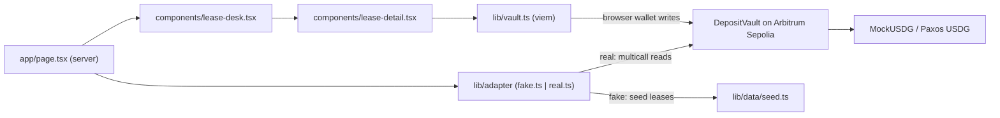

# Cautio

**Cautio holds a São Paulo rental deposit in a USDG vault on Arbitrum that neither landlord nor tenant can move alone. At move-out every deduction is its own photo-backed line, and a dispute ends with an arbiter picking one of two sealed final offers, so the tenant is no longer handed one unexplained lump sum.**

- Live: https://cautio-beta.vercel.app
- Click: DEMO step 2, `/?lease=rua-harmonia-302`

**Real or simulated on the live URL.** The status line above the desk says which. While it reads "Sample leases shown: DepositVault is not deployed in this build yet", the desk shows the ten seeded leases and every write is simulated in the browser; the block number under it is still a real Arbitrum Sepolia read. Once a vault is deployed it reads "Live: DepositVault 0x… on Arbitrum Sepolia, block N" and the two anchor leases sign real DepositVault transactions.

### Try it in 60 seconds

1. Open https://cautio-beta.vercel.app/?lease=rua-harmonia-302. Otávio listed a cracked window (400 USDG) and a repaint (900 USDG). Accept the window, dispute the paint, press "Send answers to the vault".
2. Drag Otávio's marker to 900 and Larissa's to 300 on the sealed-offer rails (the preview reads "Otávio gets 700 · Larissa gets back 2,300"), seal both, press "Open both offers", pick Larissa's 300, then "Settle in one transaction": 700 to Otávio, 2,300 back to Larissa.
3. Open https://cautio-beta.vercel.app/?lease=alameda-santos-1140. The landlord never listed anything; press "Claim full refund of 3,600 USDG".

## Architecture



Reads go through `getAdapter()` on the server (`ADAPTER_MODE=fake` by default, `real` reads DepositVault). Writes go through `sendVaultTx()` in `lib/vault.ts` in the browser: real with a vault address and a wallet, simulated otherwise.

## The problem

In Brazil a tenant usually hands over a cash caução of up to three months' rent. The law expects that money to sit in an account tied to the lease. The sources we found agree it rarely does: it sits in the landlord's own account.

At move-out the landlord announces one number. A tenant in Vila Madalena waiting on 3,000 back gets told "2,100 is going to the paint and the window", with nothing to contest line by line. The fight moves to Reclame Aqui or small claims court. The small agency managing the lease has no fair tool either, so it sides with whoever pays its fee.

## The solution

Cautio puts the deposit in a contract that neither side can move alone, and changes what each side is allowed to do:

1. **Lock.** The tenant deposits USDG into `DepositVault`. Landlord and arbiter (usually the agency) are fixed on day one.
2. **Itemize.** After move-out the landlord has 30 days to list deductions. Each line carries an amount and the SHA-256 of a move-in photo and a move-out photo.
3. **Answer.** The tenant accepts or disputes each line. Accepted lines are settled.
4. **Seal.** For the disputed total, both sides commit `keccak256(id, sender, amount, salt)`. Nobody sees the other's number.
5. **Pick.** After both reveal, the arbiter must choose one of the two numbers. There is no averaging. An extreme offer loses whole, so both sides offer something close to fair (this is final-offer arbitration, as in baseball salary disputes).
6. **Settle.** One `settle()` call pays the landlord's award and returns the rest to the tenant.

Silence always loses. If the landlord lists nothing within the window, the whole deposit opens to the tenant. If a side fails to seal or reveal, the other side's position stands.

## How it uses Arbitrum and USDG

- **Arbitrum Sepolia (421614)** hosts `DepositVault`, one Solidity contract with an explicit state machine (`Active, MoveOut, Itemized, Sealed, Revealed, Ruled, Settled`), custom errors, a reentrancy guard and checks-effects-interactions. Every waiting phase has a deadline and a `resolveTimeout()` path.
- **Paxos USDG** is the deposit currency. Before each payout the vault calls USDG's `isFrozen()`. A frozen recipient's share is credited to `owed` and pulled later with `withdraw()`, so one frozen wallet cannot block the other side's refund. Until a USDG address on Arbitrum Sepolia is confirmed, the demo uses `MockUSDG` with the same surface; the vault takes the token address in its constructor, so switching is a redeploy, not a code change.
- **viem** reads the chain over the public RPC from the first page load (the status line above the desk shows the live block number) and computes the exact commit hash the contract verifies. With `ADAPTER_MODE=real` the desk itself is read from DepositVault. With a vault address and a browser wallet, the two demo anchor leases sign real DepositVault transactions, each wallet only for its own role (tenant, landlord or arbiter), and the receipt row links to Arbiscan. The other sample leases stay simulated.
- **Web Crypto** hashes photos in the browser. The photo never leaves the device; only its hash goes on chain.

| | Cautio | Rentible | RentSafe | Kleros Escrow, Trustless Work |
| --- | --- | --- | --- | --- |
| Per-item deductions with photo hashes | yes | no | partial | no |
| Dispute resolution | sealed final offers, arbiter picks one | landlord keeps it if nobody objects | none found | general jury or approver |
| Silent landlord | full refund after 30 days | not documented | not documented | not rent specific |

## Prize tracks

| Bounty | Prize | Slots | Required tech | Code file | DEMO step |
| --- | --- | --- | --- | --- | --- |
| Overall Prize First Place | First Place 30,000 USDC | 1 | Arbitrum chain | `contracts/src/DepositVault.sol` | 3 |
| Promising Products Track First Place | First Place 7,000 USDC | 1 | Arbitrum chain | `contracts/src/DepositVault.sol` | 3 |

There are no sponsor bounty rows in this hackathon; both rows are main placements.

Qualification, quoted from the hackathon page: "Your project must be deployed on an Arbitrum chain to qualify". DepositVault and MockUSDG run on Arbitrum Sepolia (chain id 421614).

**USDG (extra consideration).** Quoted from the hackathon page: "Extra consideration is given to projects integrating Paxos' USDG stablecoin ." USDG is load bearing in two places:

- `contracts/src/DepositVault.sol`: the `IUSDG` interface is the vault's only token type; `_isFrozen` asks USDG's `isFrozen()` before every payout; `_payOut` pushes each share or credits `owed` for a frozen recipient; `withdraw` pulls a held share later.
- `lib/vault.ts`: before `openLease`, the browser wallet calls `approve` on the address the vault returns from `token()`, for exactly the deposit.

Depth test: remove `token` from the vault and DEMO steps 1, 3 and 5 break, because there is no deposit to lock or pay out. On testnet the vault runs on `MockUSDG`, which has the same surface (6 decimals, `isFrozen`, owner-only freeze).

## Tech stack

Next.js 15 (App Router), React 19, TypeScript 5, Tailwind CSS v4, shadcn-style primitives on class-variance-authority, lucide-react icons, Motion 14 (shared layout, the draggable offer rail, presence staging), viem 2, zod 3, Solidity 0.8.24 with Foundry in `contracts/`, Arbitrum Sepolia, Paxos USDG (MockUSDG on testnet), Vercel. The wallet layer is a small React context over viem and `window.ethereum`.

## Quickstart

```bash
git clone https://github.com/mericcintosun/cautio && cd cautio
npm install
npm run dev              # http://localhost:3000
npm run test:contracts   # forge test in contracts/
npm run proof            # rewrites the proof blocks in README.md and SUBMISSION.md
```

## Addresses

<!-- PROOF:BEGIN addresses -->
| What | Where |
| --- | --- |
| Live URL | https://cautio-beta.vercel.app |
| DepositVault | Not run in this build: NEXT_PUBLIC_CONTRACT_ADDRESS is not configured. |
<!-- PROOF:END addresses -->

Written by `npm run proof` from the same read as the chain-read block below. Env keys live in `.env.example`.

## Running against a vault

The app runs with no environment variables: it reads Arbitrum Sepolia live and shows ten seeded São Paulo leases, and every write is simulated. To point it at a deployed vault, copy `.env.example` to `.env.local`, set `NEXT_PUBLIC_CONTRACT_ADDRESS`, and set `ADAPTER_MODE=real` to read the desk from the chain. Writes then go through your browser wallet on Arbitrum Sepolia.

Contracts and proof:

```bash
npm run test:contracts   # forge test -vv in contracts/, including the fuzz test
npm run proof            # fills the "On-chain proof" blocks below (always exits 0)
cd contracts
PRIVATE_KEY=0x... forge script script/Deploy.s.sol --rpc-url https://sepolia-rollup.arbitrum.io/rpc --broadcast
```

See `contracts/README.md` for the smoke script, verification and the full timeout table.

## On-chain proof

Written by `npm run proof`. Each block says plainly when it has not run.

**Chain read**

<!-- PROOF:BEGIN chain-read -->
Arbitrum Sepolia (421614) block 332592216 read in 234 ms on 2026-11-25T12:10:20.406Z.

Not run in this build: NEXT_PUBLIC_CONTRACT_ADDRESS is not configured.
<!-- PROOF:END chain-read -->

**Contract tests**

<!-- PROOF:BEGIN forge-test -->
```
Suite result: ok. 12 passed; 0 failed; 0 skipped; finished in 81.11ms (85.20ms CPU time)
Ran 1 test suite in 82.18ms (81.11ms CPU time): 12 tests passed, 0 failed, 0 skipped (12 total tests)
```

`forge test` in contracts/, exit code 0, 2026-11-25T12:10:20.823Z.
<!-- PROOF:END forge-test -->

**Demo state (anchor leases)**

<!-- PROOF:BEGIN demo-state -->
Not run in this build: NEXT_PUBLIC_CONTRACT_ADDRESS is not configured.
<!-- PROOF:END demo-state -->

## Demo reset

The wow step needs three wallets, because DepositVault checks `msg.sender` for every side: the tenant (Larissa), the landlord (Otávio) and the arbiter (Camila).

1. Generate three keys once with `cast wallet new`.
2. Put them in `.env.local` as `DEMO_TENANT_KEY`, `DEMO_LANDLORD_KEY` and `DEMO_ARBITER_KEY`, next to `PRIVATE_KEY` (the farm wallet, which pays the gas top-ups) and `DEPLOYED_CONTRACT`. These keys are read only by forge and the reset script, never by the app.
3. Import each key into its own browser profile, so each window signs as one role.
4. Run `npm run demo:reset`. It rewrites `fixtures/leases.json`, then runs `contracts/script/SeedDemo.s.sol`, which tops up each role wallet with 0.002 ETH when it holds less than 0.001, mints 10,000 MockUSDG to the tenant, and opens two fresh leases: Rua Harmonia 302 with the window (400) and the paint (900) listed, and Alameda Santos 1140 with a silent landlord whose 60 second window starts right away.

The chain is append-only, so a reset cannot rewind a lease. It opens new ones, and the desk shows only the newest lease matching each anchor fingerprint (deposit, item count, claimed total or window). Older cycles and the smoke lease disappear from the desk, so every cycle starts from the same screen. Missing keys print `Not run: missing <KEY>`; the script always exits 0.

There is no database: the chain is the store, and `lib/config.ts` says where it is. No schema push applies. The salt of a sealed offer lives in the sealing browser's localStorage (with a "Download salt backup" file next to it), which is per-user browser state, not a store.

## Try the demo

The desk opens on Rua Harmonia 302: Larissa moved out, Otávio listed a cracked window (400) and a repaint (900). Accept the window, dispute the paint, seal 900 for Otávio and 300 for Larissa, open both, and let Camila pick. Settle shows the split. Then open Alameda Santos 1140, where the landlord never listed anything, and claim the full refund. Last, on the lease Larissa opened in step 1, start the move-out and list the two deductions live from Otávio's wallet (DEMO step 6).

## Security

See `SECURITY.md` for the contract address, wallet permissions and the exact approval the app asks for. DepositVault measures every deposit it pulls in, emits `Settled` with both parties, and has an owner pause that stops new deposits only: moves, timeouts, settle and withdraw keep working while paused.

## What we would build next

- Foundry tests for every timeout path, plus Arbiscan verification.
- An agency pilot with one São Paulo imobiliária managing 50 live leases from one panel.
- Pix on-ramp so a tenant can fund the deposit in reais and get USDG locked in one step.
- Deployment on Robinhood Chain alongside Arbitrum Sepolia.

## AI use

AI coding assistants (Claude Code) wrote most of the code in this repository under the builder's direction: the builder set the product, the contract rules and the demo path, and reviewed and ran what was written. The hackathon page states no AI policy; the Terms and Conditions PDF was not readable when this was written.

## License

MIT, see LICENSE.
